# Ember for Garmin fēnix 7X

Ember is a Connect IQ watch face for the fēnix 7X's round 280×280 MIP display. The app starts on Ember and includes eight more layouts. Every layout shows time, date, battery, today's steps, heart rate, and running, cycling, and swimming kilometers from activities that started in the last 168 hours.

## Layouts

All images are exports from the Garmin fēnix 7X simulator. DEMO marks synthetic data.

<p align="center">
  
  <br><strong>Ember</strong> · Split-color time, two dials, and a battery arc around the bezel
</p>

<table>
  <tr>
    <td align="center">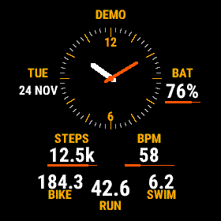<br><strong>Field Compass</strong> · Under review<br>Analog hands above the training readouts</td>
    <td align="center">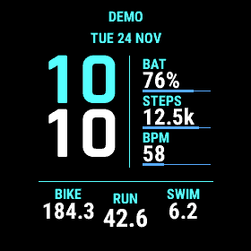<br><strong>Split Clock</strong><br>Stacked time beside the daily gauges</td>
  </tr>
  <tr>
    <td align="center">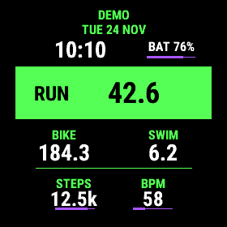<br><strong>Training Ledger</strong><br>Running distance gets the center band</td>
    <td align="center">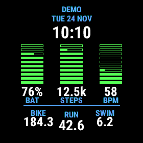<br><strong>Signal Bars</strong><br>Segmented columns for battery, steps, and HR</td>
  </tr>
  <tr>
    <td align="center">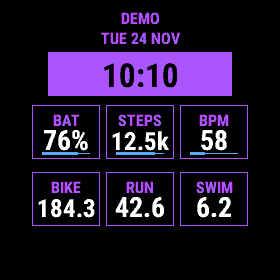<br><strong>Metric Grid</strong><br>Six metric tiles below the clock</td>
    <td align="center"><br><strong>Type Study</strong><br>Large white time and simple typography</td>
  </tr>
  <tr>
    <td align="center">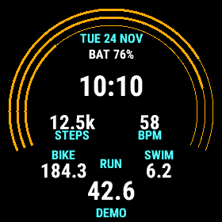<br><strong>Track Ring</strong><br>Concentric battery, steps, and HR gauges</td>
    <td align="center">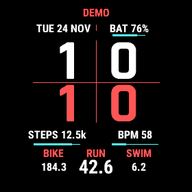<br><strong>Quadrant Clock</strong><br>One panel for each time digit</td>
  </tr>
</table>

[Open the full comparison gallery](docs/reviews/layouts/gallery.png) · [Read the layout review](docs/reviews/2026-11-24-layout-concepts.md)

## On-watch settings

Open **Customize → Layout** to switch designs. **Accent Color** and **Gauge Color** each offer eight choices and apply across layouts when selected. Each layout has its own defaults.

**Customize → Activity Order** sets the primary, secondary, and tertiary sports across all layouts. Run, Bike, and Swim start in that order. Selecting a sport already in another slot swaps the two. [Activity Order menu](docs/reviews/layouts/activity-order.png) · [Bike as the primary sport](docs/reviews/layouts/track-ring-bike-primary.png)

<table>
  <tr>
    <td align="center">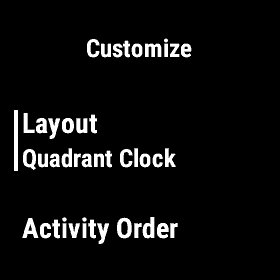<br>Customize</td>
    <td align="center">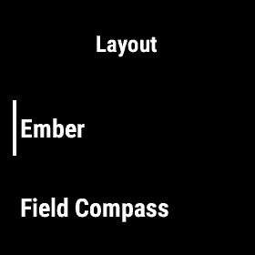<br>Layout picker</td>
    <td align="center">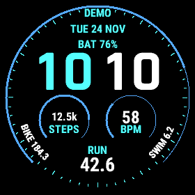<br>Ember in cyan and blue</td>
  </tr>
</table>

<details>
<summary>More simulator captures and earlier designs</summary>

### Layout checks

<table>
  <tr>
    <td align="center">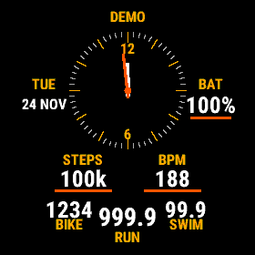<br>Field Compass at 23:59</td>
    <td align="center">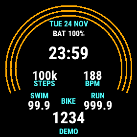<br>Track Ring with full gauges</td>
    <td align="center">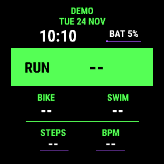<br>Training Ledger with unavailable metrics</td>
  </tr>
  <tr>
    <td align="center">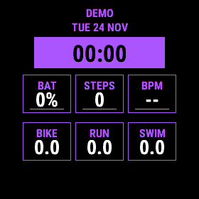<br>Metric Grid at midnight</td>
    <td align="center">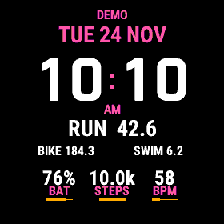<br>Type Study at the steps goal</td>
    <td align="center">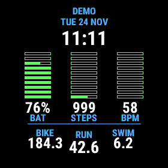<br>Signal Bars without an HR limit</td>
  </tr>
  <tr>
    <td align="center"><br>Signal Bars in Always-Active mode</td>
    <td align="center">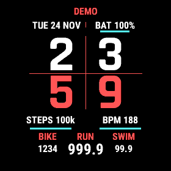<br>Quadrant Clock with long values</td>
  </tr>
</table>

### Two-color Ember checks

<table>
  <tr>
    <td align="center">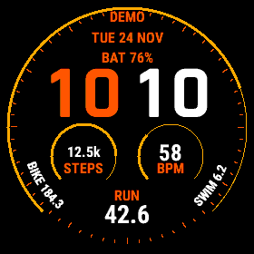<br>Orange and gold defaults</td>
    <td align="center">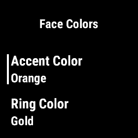<br>Original two-color settings menu</td>
    <td align="center">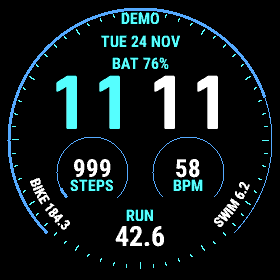<br>BPM without an HR limit</td>
  </tr>
  <tr>
    <td align="center">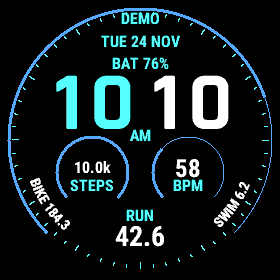<br>Daily steps goal met</td>
    <td align="center">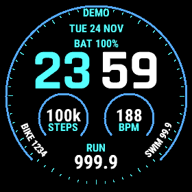<br>Long values and full battery</td>
    <td align="center">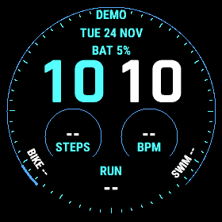<br>Missing data</td>
  </tr>
  <tr>
    <td align="center">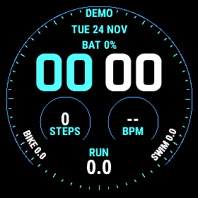<br>Midnight and zero values</td>
  </tr>
</table>

### Earlier iterations

<table>
  <tr>
    <td align="center">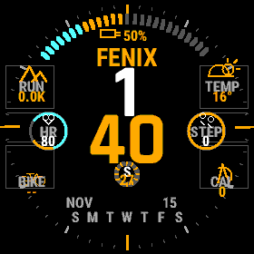<br>Original v6 baseline</td>
    <td align="center">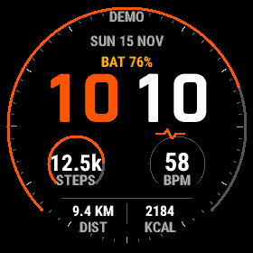<br>First candidate</td>
    <td align="center">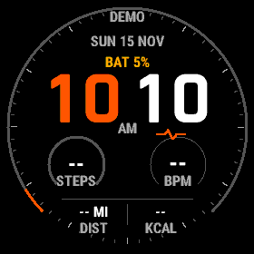<br>First candidate with missing values</td>
  </tr>
  <tr>
    <td align="center">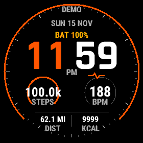<br>First candidate before the padding fix</td>
    <td align="center">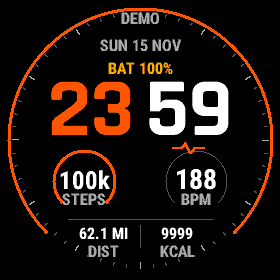<br>First candidate with long values</td>
    <td align="center">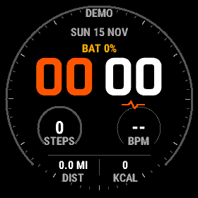<br>First candidate at midnight</td>
  </tr>
  <tr>
    <td align="center">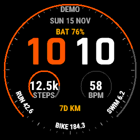<br>Early triathlon layout</td>
    <td align="center">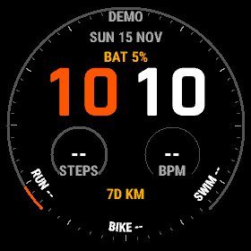<br>Triathlon layout with missing values</td>
    <td align="center">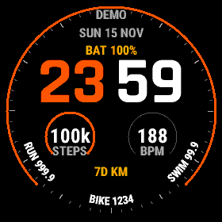<br>Triathlon layout with long values</td>
  </tr>
  <tr>
    <td align="center">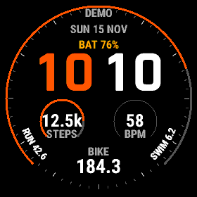<br>Cycling-focused layout</td>
    <td align="center">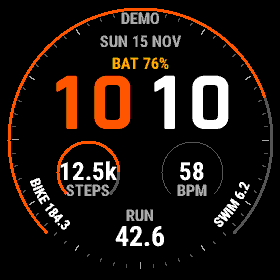<br>Running-focused layout</td>
    <td align="center">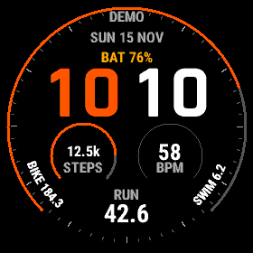<br>Running-focused layout with padded dials</td>
  </tr>
</table>

</details>

## Build and install

On macOS, install Java and Garmin Connect IQ SDK Manager, then download the `fenix7x` device definition.

```sh
./scripts/ciq keygen      # creates a development signing key outside Git
./scripts/ciq doctor
./scripts/ciq build
./scripts/ciq simulator
./scripts/ciq run         # once the simulator is up
./scripts/ciq test
```

The standard build is `build/Fenix7XVibeFace.prg`. It keeps the original app ID and includes all nine layouts. Follow the [USB/MTP sideload guide](docs/INSTALL_ON_WATCH.md) to install it. Save the signing key for updates. The build script reads Garmin's `current-sdk.cfg` and supports `CIQ_SDK`, `CIQ_DATA`, `CIQ_DEVICE`, and `CIQ_KEY` overrides.

To build a separately installable copy with a different starting layout, set `CIQ_LAYOUT` to one of the [review profile keys](docs/reviews/2026-11-24-layout-concepts.md#customize-and-build).

```sh
CIQ_LAYOUT=ember ./scripts/ciq build            # EmberLayoutLab.prg
CIQ_LAYOUT=field-compass ./scripts/ciq build    # FieldCompass.prg
./scripts/ciq preview-build populated
./scripts/ciq preview-run
```

Preview builds use fixtures and display DEMO. Copy only the live build to the watch.

## Data and shortcuts

Sport totals use the watch's saved activity history. The steps gauge uses the daily goal. The HR gauge uses the upper threshold of the watch's generic Zone 5 when available. With touch enabled, press and hold the date, battery, steps, HR, RUN, or BIKE to request its native Garmin screen. Swimming is display-only.

The layouts and settings were verified in the Garmin simulator. Check native shortcuts, synced activity coverage, and readability on the physical watch. The [project bible](docs/PROJECT_BIBLE.md), [development setup](docs/SETUP.md), and [handoff](docs/AGENT_HANDOFF.md) record the design and verification details.
