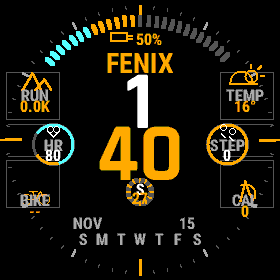
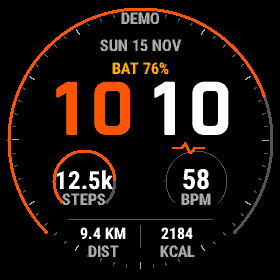

# First candidate review

Device: fēnix 7X, 280×280 MIP. SDK: 9.3.0. Original baseline: commit `297a7cd`. Candidate: local working tree on `revive/instrument-face`, 2026-11-15.

All PNGs here were exported using **File → Save Screen Capture in the actual Garmin simulator**. They are 280×280 screen images. The synthetic states are marked DEMO. The simulator supplies the date; the fixture fixes metrics/time. These are not physical-watch photographs.

## Baseline and candidate

| Original v6 | First replacement, populated fixture |
| --- | --- |
|  |  |

Baseline observations: icons overlap metric labels; side panels are cramped; seconds dial is illegible; prominent FENIX heading uses space without conveying data. Code also mislabels aggregate distance as weekly running and leaves cycling permanently blank.

Candidate hypothesis: a wide time row and fewer, larger data groups will read better. Battery moves to the perimeter with an explicit BAT percentage; steps retain a meaningful goal arc; HR has a simple open frame and no arbitrary HR/180 progress. Daily distance and calories have dedicated footer slots. Seconds and the large brand heading are removed.

Observed result: time dominates, label/value groups no longer overlap in the recorded states, and peripheral text remains inside the round boundary. Native-size and enlarged images were inspected. The populated step value is close to its frame but remains inside it; preserve this constraint in future typography changes. The design is a clean starting point; the owner's aesthetic acceptance is still pending.

## Defects caught and corrected

1. First synthetic preview used live-clock AM/PM with fixture time. Period now derives from the displayed hour.
2. Initial step text used a larger font and crowded its frame. Switched to the smaller numeric text treatment.
3. Extreme fixture rendered `100.0k` too wide. Values rounding to 100k or above now use whole thousands. `candidate-extreme-before-fix.png` preserves the observed defect; `candidate-extreme.png` records its correction.
4. Replaced the inherited 16px launcher icon with a native 40px SVG asset, added English to the manifest, and fixed new container typing warnings. Final builds have no diagnostics.

## State checks

| Capture | What was checked | Result |
| --- | --- | --- |
| `candidate-populated.png` | 10:10, 12.5k steps/15k goal, HR 58, 76% battery, 9.4km, 2184kcal | Groups fit; metric conversion displayed |
| `candidate-missing.png` | Missing steps/goal/HR/distance/calories, low battery; 12h time | Explicit dashes; no invented metric zeros or goal progress; AM matches fixture |
| `candidate-extreme.png` | 23:59, 100k steps exceeding goal, HR 188, full battery, 9999kcal; 24h time | Corrected step value fits, goal arc clamps, time and footer fit |
| `candidate-midnight.png` | 00:00, zero steps/distance/calories, zero goal, zero battery | No divide-by-zero, zero remains distinct from missing |

Statute distance was observed in missing/extreme runs. Metric distance was observed in the populated run. The extreme pre-fix screenshot also demonstrates 11:59 PM in 12h mode. The live build was subsequently launched and inspected in the simulator; it rendered simulator-native metrics with no DEMO marker and no visible runtime error.

## Remaining work

Owner feedback on the visual direction; physical MIP screen inspection; power/lifecycle diagnostics; additional field-size/date/localization combinations and actual data freshness behavior. No battery-life claim is supported yet. Weather and sport-specific weekly totals are deliberately deferred until a verified source and a useful layout are established.
