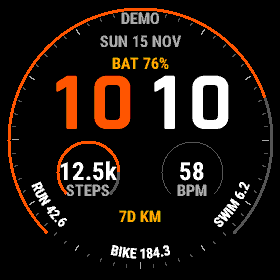
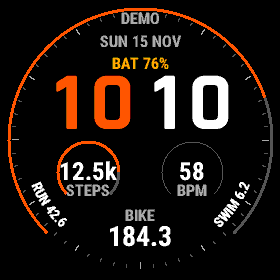
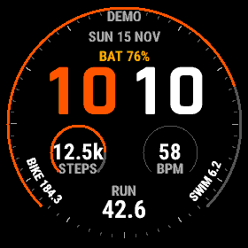
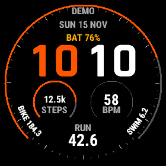

# Rolling sport totals around the bezel

Owner brief: keep battery percentage, time, steps; add running, cycling and swimming kilometers for the **last seven days**, retain HR if readable. Suggested placement: around the bezel. The first candidate's visual direction was positively received.

## Result

Actual fēnix 7X simulator export, 280×280, SDK 9.3.0 / device API 5.2.0. The DEMO marker identifies synthetic time/metrics. The screenshot is not the owner's training data.

The three lower edge labels use native curved text at radius 113. The inner `7D KM` label specifies both period and units; RUN/BIKE/SWIM are always kilometers. Time remains the largest element. Steps retain the goal arc; HR remains available in the right-hand dial. The first candidate's daily distance and calorie footer is removed.

During inspection, shrinking the meter radii to 28px made the step value crowd its frame. Restoring both to 31px gives the value enough room. The obsolete pulse decoration was removed to keep space above the HR dial. Both current meters and all three sport labels fit in native-size and enlarged inspections.

Additional exports: [missing data](triathlon-missing.png), [large values](triathlon-extreme.png). Checked dashes, low/full battery, 100k steps, 188 BPM, RUN 999.9km, BIKE 1234km, SWIM 99.9km and 23:59. Long radial labels remain inside the screen without colliding with the meters or neighboring labels. Font-unavailable fallback and the full lifecycle/power matrix are not yet visually verified.

## Data implementation

`UserProfile.getUserActivityHistory()` supplies saved activity sport, start time and distance in meters. `RollingSportTotals` sums explicit running/cycling/swimming records with start times in `(now − 604800, now]`. It does not use calendar-week complications or walking-distance summaries. Cache refresh is at most every 15 minutes and earlier at the next included activity's expiry; a new/showing view invalidates the cache. Clock rollback triggers a refresh. Wrist wake redraws without automatically rescanning.

The native `UserProfile` permission was added. No data is sent to a network service. Relevant missing dates/distances mark that sport unavailable, rather than fabricating a zero. Accessible empty history returns zero; this reflects the API's records, not a guarantee that the watch has a complete Garmin Connect account history. Records with unknown/unrelated sport enums are not assigned to run/bike/swim. Generic multisport sessions are not split by inference.

The earlier claim that sport-specific totals require a companion source was too restrictive. This native API provides the necessary fields; physical-watch data fidelity still needs checking.

## Verification

- Live and preview builds: successful, no compiler warnings.
- `./scripts/ciq test`: two tests passed in the Garmin simulator (`trailingSevenDays`, `uncertainSportIsNotZero`).
- Semantic coverage: exact cutoff excluded, just-inside cutoff counted, current timestamp counted, future timestamp excluded, unsorted independent sports, walking excluded, time advance expires old activity, missing date/distance, zero distance, old records excluded, implausible legacy timestamps unavailable.
- SDK 9.3's test runner returned exit code 1 despite an explicit PASSED report. The wrapper now requires a fresh, nonempty report with zero failures/errors, and returns failure if that report is absent. The revised command was rerun and exited successfully.
- Preview source is separate from the live adapter and is marked DEMO. Live build uses native activity history.

## Physical-watch acceptance still needed

Compare totals against saved sessions on the fēnix 7X, especially a ride recorded on an Edge/indoor platform and pool/open-water swims. Confirm whether synchronized sessions and triathlon legs appear separately through this API. Check timestamp correctness on the owner's firmware, post-save refresh, retention/deletion behavior, readability and power cost. Do not claim Garmin Connect account-wide completeness or battery-life validation from simulator results.

Primary references: [UserProfile history method](https://developer.garmin.com/connect-iq/api-docs/Toybox/UserProfile.html#getUserActivityHistory-instance_function), [activity fields and units](https://developer.garmin.com/connect-iq/api-docs/Toybox/UserProfile/UserActivity.html), [native radial text API](https://developer.garmin.com/connect-iq/api-docs/Toybox/Graphics/Dc.html#drawRadialText-instance_function).

## Owner refinement: remove the period/unit legend

The owner knows the totals' meaning and requested using the legend's space better. Removed `7D KM` and moved BIKE from the small curved bottom readout to an upright label at y=214 with a larger value at y=235. RUN/SWIM retain their curved positions. No metric semantics changed.

Live and populated-preview builds pass without warnings. The populated render was exported and inspected in the native simulator: the larger value fits inside the circle without touching the side sport labels. This screenshot supersedes the earlier populated screenshot as the current design.

## Final priority correction before merging

The owner clarified that RUN should be prominent, rather than BIKE. The bottom-center label/value now show running kilometers, with cycling on the lower-left curve and swimming on the lower-right. `triathlon-run-focus.png` is the current populated simulator export; `triathlon-bike-focus.png` records the intermediate attempt. Builds and both semantic tests pass after this change; the current populated native and enlarged render were inspected.

## Final padding and interaction fixes

The owner correctly observed step text crossing the smaller dial. Both frames now have 36px radii, centers (92,172)/(188,172), inward label/value offsets and a measured width limit for step text. Inspected populated simulator export: `triathlon-run-padded.png`. This is the current design; earlier images remain evidence of the actual iterations, not accepted final padding.

DEMO appears only on the separate synthetic preview build. The live build has no marker.

Added touch-and-hold hit regions for native battery/date/steps/HR and run/bike history complications. Swim remains display-only because no matching native complication exists. The native run/bike destinations may use calendar-week views; they do not change our trailing-168-hour calculation. All three tests pass, including a new hit-region test. A simulator long-press attempt did not visibly open a native app; destination behavior remains unverified until on-device testing. Live/preview builds pass without warnings.
