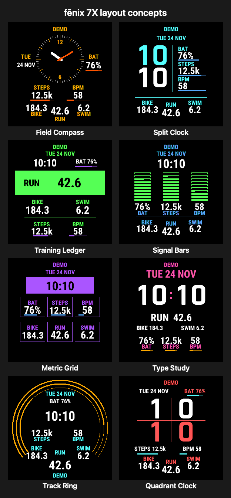

# fēnix 7X layout concepts

Each layout uses the same live time, date, battery, steps, heart rate, and trailing-168-hour running, cycling and swimming totals. Capacities use battery percentage, steps against the daily goal, and BPM against the upper limit of Garmin's general Zone 5. Metric shortcuts follow their visible positions.



| Layout | Design | Simulator capture |
| --- | --- | --- |
| Field Compass | Analog hands, date and battery flanking the dial, training readouts below | [Field Compass](layouts/field-compass.png) |
| Split Clock | Stacked digital time next to three narrow daily progress rows | [Split Clock](layouts/split-clock.png) |
| Training Ledger | Inverted running-distance banner, compact time header | [Training Ledger](layouts/training-ledger.png) |
| Signal Bars | Three ten-segment progress columns with position and height encoding | [Signal Bars](layouts/signal-bars.png) |
| Metric Grid | Six equally sized metric tiles below a time banner | [Metric Grid](layouts/metric-grid.png) |
| Type Study | Large white time and a sparse, type-led hierarchy | [Type Study](layouts/type-study.png) |
| Track Ring | Three concentric tracks, outer for battery, middle for steps, inner for HR | [Track Ring](layouts/track-ring.png) |
| Quadrant Clock | Four individual time digits in a crosshair grid | [Quadrant Clock](layouts/quadrant-clock.png) |

## Customize and build

**Customize → Layout** switches layouts in the same installed app. **Accent Color** and **Gauge Color** apply across layouts when explicitly selected. Until then, each layout has its own default pair. The saved layout uses a stable ID so the options can be reordered or pruned. A missing option falls back to the build's default.

[Customize menu](layouts/customize.png) · [Layout menu](layouts/layout-menu.png) · [Approved Ember layout](layouts/ember.png)

`./scripts/ciq build` makes the standalone review app `build/EmberLayoutLab.prg`, which starts on Ember and includes all nine layouts. A specific concept starts on its own layout and gets a separate Garmin application ID and file name. For example:

```sh
CIQ_LAYOUT=field-compass ./scripts/ciq build
CIQ_LAYOUT=field-compass ./scripts/ciq preview-build populated
CIQ_LAYOUT=field-compass ./scripts/ciq preview-run
```

The other review profile keys are `split-clock`, `training-ledger`, `signal-bars`, `metric-grid`, `type-study`, `track-ring`, and `quadrant-clock`. The unmodified app on `main` keeps its original ID.

## Simulator review

Reviewed against the Garmin fēnix 7X profile at 280×280 on SDK 9.3.0, API 5.2.0. DEMO identifies fixture data. The gallery places the native exports side by side at their original resolution.

- The initial render exposed several footer labels and tile corners past the circular bezel. Inset the affected positions and checked the final populated exports against the circle. Moved the Track Ring DEMO marker away from the rings and shortened the Compass hands so they clear the cardinal labels.
- Ember matched the approved default simulator capture pixel for pixel with the same fixture and date.
- Checked [23:59 analog hands and long values](layouts/field-compass-extreme.png), [23:59 and three fully filled tracks](layouts/track-ring-extreme.png), [unavailable metrics and 5% battery](layouts/training-ledger-missing.png), [midnight and zero values](layouts/metric-grid-midnight.png), [12-hour display at exactly 10,000 steps](layouts/type-study-goal.png), and [11:11, 999 steps and a BPM reading without a zone limit](layouts/signal-bars-no-hr-max.png). The Signal Bars layout also rendered with the simulator set to [Always-Active](layouts/signal-bars-always-active.png).
- All eight concept builds and the combined live review build compiled. All four simulator tests passed, including checks for the six shortcut regions across all eight new layouts.
- The layout setting switched renderers and persisted on relaunch in the Garmin simulator. Physical settings access, color under real light, shortcuts and runtime power still require on-watch verification.

[Garmin fēnix 7 watch face customization](https://www8.garmin.com/manuals/webhelp/GUID-C001C335-A8EC-4A41-AB0E-BAC434259F92/EN-US/GUID-A4EA51C3-D0B2-48E3-807A-768C6F07D7BA.html)
